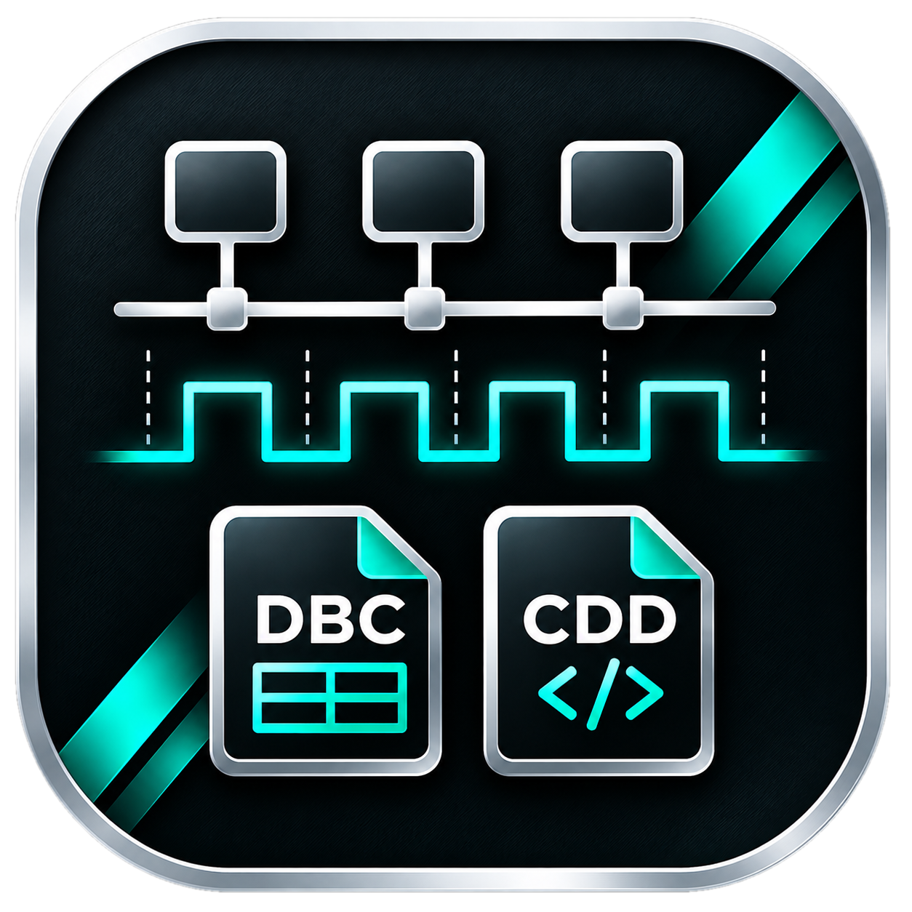

  

<h1 align="center">RBG - CAN Insight</h1>

  <strong>Turn recorded CAN and UDS traffic into understandable, traceable engineering evidence.</strong> 
  Explore logs, decode DBC signals, investigate diagnostics and compare what actually happened — all in one offline Windows workspace.

  <a href="https://github.com/Ruba94-cyber/RBG-CAN-Insight/releases/latest"><strong>Download for Windows</strong></a> ·
  <a href="#quick-start">Quick start</a> ·
  <a href="docs/USER_GUIDE.md">User guide</a> ·
  <a href="#real-world-examples">Examples</a> ·
  <a href="https://github.com/Ruba94-cyber/RBG-CAN-Insight/issues">Feedback</a> ·
  <a href="#support-development">Donate</a>

  
  
  
  
  
  

> [!IMPORTANT]
> **Licensing for future releases:** personal, non-commercial use is free; business and other commercial use requires a separate paid license. **Previously published v5.1.0 retains its original free-business-use terms**. See [Licensing](#licensing) for the precise version distinction.

> [!IMPORTANT]
> **Offline analysis only.** RBG CAN Insight reads recordings selected by the user. It **does not connect to vehicle interfaces, capture live traffic, transmit frames, send diagnostic requests, clear DTCs or perform ECU programming**. Diagnostic operations described in the app are operations *observed in a recording*, not actions the app can execute.

## Why CAN Insight?

Recorded vehicle-network data is often spread across raw logs, CAN databases, diagnostic catalogs, plots and spreadsheets. Finding an anomaly is only half the job: an engineer must also establish **which frame supports the conclusion**, **when it happened** and **which definition was used to decode it**.

**RBG - CAN Insight** brings those steps together in a local-first, English-language Windows desktop application.

A typical investigation follows the evidence:

**Trace → DBC signals → time plots and changes → ISO-TP / UDS transactions → DID–CAN comparison → report**

The goal is a straightforward first view, with more specialized analysis available when needed. It is useful for **automotive diagnostics, ECU validation, network troubleshooting, test evidence review and engineering investigations** — not just for viewing a list of CAN IDs.

## Key features

| Area | What you can do |
| --- | --- |
| **Trace analysis** | Import recorded CAN traffic, filter frames, replay an offline timeline, inspect payload differences and return to the original frame. |
| **Multi-file sessions** | Open several recordings; merge by time, append sequentially or keep input channels separate. Filter and plot by individual recording. |
| **DBC & ARXML** | Decode messages and physical signals, inspect message/signal definitions, set bus assignments, handle J1939 PGN matching and review unmatched IDs. |
| **Signals & Plot** | Search observed signals, launch Quick Plot, compare multiple curves, inspect values at X1/X2 cursors and navigate to actual changes and source frames. |
| **Change & Byte Matrix** | Find changing or stable signals, inspect the exact transition time and watch payload bytes evolve during offline replay. |
| **UDS / ISO-TP** | Reconstruct recorded requests and responses, including multi-frame transport, NRCs, DID reads, DTC memory, routines, timing and transport findings. |
| **CDD / ODX / PDX** | Load diagnostic descriptions, inspect catalog parameters and engineering PARs/Sub-PARs, and export supported diagnostic definitions. |
| **DID ↔ CAN correlation** | Compare recorded diagnostic values with decoded CAN timelines; review fit metrics, alternative candidates and the source observations supporting each result. |
| **Comparison & quality checks** | Inspect DBC/catalog consistency, compare definition versions and investigate signal, byte and diagnostic differences. |
| **Projects & reporting** | Save projects, notes, presets, layouts and watch lists; export data, evidence tables and a diagnostic report package. |
| **Command line** | Convert, inspect, merge, cut and shift traces; export physical signals; run supported definition checks and diagnostic reports. |

**Important distinction:** A statistical match is **not automatically proof** that a DID and CAN signal represent the same physical quantity. RBG CAN Insight exposes the evidence and lets the analyst review or reject suggested associations.

## Supported files

| Type | Supported inputs / purpose |
| --- | --- |
| **Recorded traces** | `.asc`, `.blf`, `.trc`, `.csv`, `.log` / `.txt`, `.mf4` / MDF4, SocketCAN `.pcap` and `.pcapng` |
| **CAN definitions** | `.dbc` and supported AUTOSAR `.arxml` definitions |
| **Diagnostic descriptions** | CDD, ODX and PDX catalogs |
| **Saved investigations** | Native projects, presets and reviewed DID–CAN mappings |
| **Outputs** | Filtered trace exports, signal CSV, CSV/XLSX analysis tables, reviewed mappings and a ZIP report containing HTML, Markdown, structured evidence and PDF summaries |

Format support can vary by format variant and application version. For example, signal-only MF4 files without raw CAN frames are not accepted, and some catalog definitions remain raw-only when safe physical decoding is not possible. Consult the [user guide](docs/USER_GUIDE.md) for details.

## Download & setup

**[Download the latest RBG CAN Insight release](https://github.com/Ruba94-cyber/RBG-CAN-Insight/releases/latest)**

1. Open **Releases** and choose the Windows package appropriate for that release.
2. For a portable package, extract the complete archive into a writable folder.
3. Launch **`RbgCanInsight.exe`** from the extracted folder.
4. Open a recorded trace and optionally load DBC, ARXML or diagnostic-description files to enrich decoding.

The documented portable layout includes local `config/`, `logs/`, `docs/` and `runtime/` directories alongside the executable. Keep the folder together when moving it between computers. If the folder is not writable, settings can fall back to `%LOCALAPPDATA%\RbgCanInsight`.

A separately distributed **[Microsoft Store edition](https://apps.microsoft.com/detail/9NTZXFCKR81D)** is also available as a paid download. The licensing policy for **future releases explicitly adopting the revised terms** is: **free for personal, non-commercial use**, with a **separate paid license required for business or other commercial use**. Store and GitHub releases may appear on different dates; purchasing the Store edition does not by itself grant commercial rights unless its applicable terms expressly say so.

> [!NOTE]
> **v5.1.0 remains under the terms offered when it was released**, which expressly permitted free business use. The revised conditions are **not retroactive**. A later release must explicitly adopt the [revised application terms](APPLICATION-TERMS.md) before they apply.

> [!NOTE]
> Use official release packages and verify any release-provided checksums or signing information before trusting an executable. A feature documented on the repository's main branch may not yet be present in an older release.

## Quick start

### 1. Open a recorded trace

Select **Open trace...**, drag a supported log into the window or use **Ctrl+O**. The Trace workspace displays timestamps, channels, CAN IDs, payloads and, where available, decoded messages and diagnostic context.

For several recordings, choose the import mode that fits your task:

- **By time:** interleave frames by recorded timestamp.
- **Sequential:** append logs, shifting overlapping start times as needed.
- **Separate channels:** preserve separation while interleaving the files.

These modes organize evidence; they **do not establish that different logger clocks were synchronized**.

### 2. Load definitions

Choose **Load DBC...** or **Ctrl+Shift+O** to add CAN definitions. Recorded frames matching those definitions become physical signals that can be searched, plotted and compared.

Use **DBC Manager** to inspect missing matches, adjust a channel assignment or enable **Match by J1939 PGN** when appropriate. Load CDD / ODX / PDX descriptions for richer diagnostic names, DID fields and DTC context.

### 3. Find the interesting signal

Press **Ctrl+K** (**Search everywhere**) and look for a signal name, message, CAN ID, ECU or DID. Open an observed result to add it to **Signals & Plot**.

From there you can:

- Use **↗ Quick Plot** to inspect a signal separately.
- Check several signals to compare them on the main chart.
- Place **X1 and X2** cursors to inspect elapsed time and recorded values.
- Press **F3 / Shift+F3** to jump between actual signal changes.
- Follow the source-frame reference back to **Trace**.

The chart distinguishes recorded samples from optional visual interpolation. A flat held line does not mean the bus sent new samples throughout the interval.

### 4. Investigate and export

Use **Change Matrix**, **Byte Matrix** and **Statistics** for signal or payload behavior. Open **UDS Analysis** for reconstructed diagnostic transactions, negative responses, DTC evidence, routines and timing findings. Use **DID-CAN Mapping** to review candidate relationships.

Save your project or investigation preset, then use **Export report** to package the available evidence for review.

## Real-world examples

### Example 1 — Why did a signal jump?

**Situation:** an engineer notices an unexpected change in vehicle speed or temperature during a recorded test.

1. Import the trace and the relevant DBC.
2. Search for the observed signal with **Ctrl+K** and open it in **Signals & Plot**.
3. Use **F3** to reach the next recorded change, or inspect **Change Matrix** for the before/after value, delta and timestamp.
4. Compare related signals with X1/X2 cursors, then open the referenced raw CAN frame.
5. Record the finding and export the evidence.

**Result:** a reproducible path from a plotted change to the message, channel, timestamp and source payload that produced it.

### Example 2 — Investigate a negative UDS response

**Situation:** a diagnostic session contains a `ReadDataByIdentifier` request that did not succeed.

1. Import the recorded diagnostic trace.
2. Open **UDS Analysis → Transactions** and filter negative or missing responses.
3. Select the transaction to inspect the service, DID, NRC interpretation, timing and ISO-TP status.
4. Use **Open raw frames** to verify the original request and response evidence.
5. If a CDD/ODX catalog is available, inspect the resolved DID name and declared fields.

**Illustration:** an observed UDS request for DID `0xF190` uses service `0x22`; a positive response uses `0x62`. A negative response has service `0x7F` and an NRC that must be interpreted in its recorded context. These are protocol examples, not sample data bundled with the app.

### Example 3 — Compare a diagnostic DID with a CAN signal

**Situation:** a physical measurement is present both in recorded UDS reads and on the CAN network.

1. Load the trace, DBC and relevant CDD / ODX / PDX description.
2. Inspect recorded DID samples in **UDS Analysis**.
3. Run candidate analysis in **DID-CAN Mapping** or inspect the **UDS ↔ CAN correlation** view.
4. Review timing alignment, sample coverage, correlation, scaling and source-frame references.
5. Confirm, reject or leave the association for further engineering review; save the map as `.rbgmap.json`.

**Result:** a documented hypothesis rather than an unexplained “confidence” percentage. Insufficient, competing or contradictory evidence remains visible.

### Example 4 — Review two recordings without mixing their signals

**Situation:** you need to compare behavior from two loggers or test runs.

1. Import both logs and select the appropriate multi-file mode.
2. In **Signals & Plot**, select **Logger 1**, **Logger 2** or **All recordings**.
3. Search for a signal with a recording-scoped term such as `logger:2 EngCoolantTemp`.
4. Plot and compare the chosen series, retaining the identity of their original recordings.
5. Check timestamps and recording boundaries before drawing a cross-logger conclusion.

**Result:** clearer multi-file investigations without silently treating identically named signals from different files as one source.

## Useful searches & shortcuts

In the Trace workspace, **Enter filters rows**, while **F3 / Shift+F3** navigates matching rows without hiding the rest. Space-separated search terms are combined with AND.

| Example | Purpose |
| --- | --- |
| `id:100..1FF` | Restrict CAN identifiers to a hex range |
| `d0&0F=05` | Match a masked value in data byte 0 |
| `t:1.5..3` | Focus the time interval from 1.5 to 3 seconds |
| `payload:62F190` | Search a payload fragment |
| `dir:tx` | Find frames explicitly marked transmitted by the log |
| `ch2 EngCoolantTemp` | Search an observed signal on channel 2 |

**Caution:** `dir:rx` means “not logged as transmitted”; many recording formats do not preserve the direction, so that filter does **not** prove a frame was received.

| Shortcut | Action |
| --- | --- |
| `Ctrl+O` | Open trace |
| `Ctrl+Shift+O` | Load DBC |
| `Ctrl+K` | Search everywhere |
| `Ctrl+F` | Focus search in the active workspace |
| `F3 / Shift+F3` | Next / previous search match or recorded signal change, by workspace |
| `Ctrl+Enter` | Quick Plot for the selected signal in Signals & Plot |
| `F7 / Shift+F7` | Step offline replay forward / back in Trace |
| `F8 / F9` | Animate / run offline replay |
| `Ctrl+E` | Export report |
| `F1` | Open the guided application tour |

More filters, keyboard controls and investigation tools are documented in the **[full user guide](docs/USER_GUIDE.md)**.

## Reporting & reproducibility

**Export report** can produce a ZIP package including `summary.md`, `report.html`, statistics, DBC coverage, UDS transactions, DID samples, fault-memory observations, diagnostic findings and correlation evidence. A PDF diagnostic summary is included in the documented report output.

Native projects preserve source-file references and SHA-256 fingerprints, and the app checks for missing or changed inputs when reopening a project. Reviewed DID–CAN mappings can be saved and compared separately.

These features help keep conclusions auditable, but **all results still depend on recording quality, catalog completeness and analyst interpretation**.

## Command-line tools

The repository also includes the separate **`rbgcan` CLI project** for scripted offline analysis. Build it from source; do not assume it is bundled with every graphical release.

After building the CLI and making `rbgcan` available in your terminal:

~~~powershell
# Inspect a recording and measure DBC coverage
rbgcan info drive.blf --dbc powertrain.dbc

# Convert a supported trace to ASC
rbgcan convert drive.mf4 drive.asc

# Combine recordings, preserving separate input channels
rbgcan merge combined.asc run1.blf run2.blf

# Extract a time window (seconds from the first frame)
rbgcan cut drive.blf event.blf --from 10 --to 25

# Export selected decoded physical signals
rbgcan export-signals drive.blf powertrain.dbc signals.csv --signals EngSpeed,VehicleSpeed

# Validate a DBC and generate a CSV of findings
rbgcan check-dbc powertrain.dbc --out dbc-findings.csv
~~~

Other documented commands cover timestamp shifts, catalog checks, definition comparisons, ODX export and diagnostic timing/fault reports. Run `rbgcan --help` to see the commands offered by your built version; see [Command line in the user guide](docs/USER_GUIDE.md#8-command-line-rbgcan) for reference.

## Build & test from source

The solution is a **Windows WPF / .NET 10** desktop application. A compatible Windows development environment and the **.NET 10 SDK** are required.

~~~powershell
dotnet build RbgCanInsight.sln -c Release
dotnet test tests/RbgCanInsight.Tests/RbgCanInsight.Tests.csproj -c Release
dotnet build tools/RbgCanInsight.Cli/RbgCanInsight.Cli.csproj -c Release
~~~

GUI automation and some packaging or installer checks require an interactive Windows desktop and additional tooling. Passing unit tests is not a substitute for validating a release on real representative traces and diagnostic catalogs.

## Tips & troubleshooting

- **No frames visible?** Clear Trace filters with **Esc**, switch back to **All frames** and inspect the import-quality details.
- **DBC decodes nothing?** Check the correct bus/channel, 11-/29-bit identifier interpretation and the **Unmatched trace IDs** panel.
- **A signal does not appear in Plot?** First verify that the loaded trace contains decoded observations for that signal. A definition alone cannot generate recorded data.
- **Different loggers seem misaligned?** Check recording clocks and import mode before interpreting timing differences.
- **A diagnostic value stays raw?** The source catalog may not provide a reliable field width, type or offset. Review the original description rather than inferring a conversion.
- **A DID–CAN result looks convincing?** Review independent samples, timing, alternative candidates and source frames before confirming it.

For deeper explanations, see [Troubleshooting](docs/USER_GUIDE.md#9-troubleshooting).

## Privacy, feedback & development

RBG CAN Insight processes files **locally**, does not require an account and does not intentionally upload traces, catalogs, projects or reports. Read the **[privacy policy](docs/PRIVACY_POLICY.md)**.

Found a problem or have an improvement idea? **[Open a GitHub issue](https://github.com/Ruba94-cyber/RBG-CAN-Insight/issues)** with the app version, Windows version, steps to reproduce, expected behavior and (where possible) a **sanitized or synthetic recording**. Please do not share confidential OEM, vehicle or customer data publicly.

## Support development

RBG CAN Insight is independently developed. Optional donations help fund maintenance, testing, compatibility work and future improvements. **Donations do not replace or include a commercial license.**

**[❤️ Support RBG CAN Insight with a PayPal donation](https://www.paypal.com/donate?business=paolo.ruba.1913%40gmail.com&no_recurring=0&item_name=Support+RBG+CAN+Insight&currency_code=EUR)**

## Licensing

The **new distribution model** is designed to keep RBG CAN Insight accessible to individuals while requiring an agreement for professional deployment. **It applies only to future application releases that explicitly adopt the updated [application terms](APPLICATION-TERMS.md).**

| Intended use | New-release licensing policy |
| --- | --- |
| **Personal learning, hobby or independent non-commercial projects** | **Free** for individual, non-commercial use |
| **Personal non-commercial trace analysis** | **Free** when not performed for an employer, business or client |
| **Internal company diagnostics, testing or validation** | **Separate paid commercial license required** |
| **Professional consulting, paid services or client projects** | **Separate paid commercial license required** |
| **Redistribution, source modification or integration into another product** | **Separate written permission** required |

**Business use includes internal company use**, even if the software itself is not resold. For commercial licensing, contact **paolo.ruba.1913@gmail.com** before using a release governed by the new terms. A Microsoft Store purchase or voluntary donation is not automatically a commercial-use license; check the applicable terms.

**Previously released versions retain their original rights.** In particular, **[v5.1.0](https://github.com/Ruba94-cyber/RBG-CAN-Insight/releases/tag/v5.1.0)** explicitly permitted free business use when published. Updating repository documentation does not revoke that previously granted permission.

**Source code:** proprietary, all rights reserved under the **[source-code license](LICENSE.md)**. Public repository visibility does **not** mean the source is open source or available for reuse.

For the detailed scope, version applicability, limitations and contact details, read the **[application terms](APPLICATION-TERMS.md)**. Third-party components retain their own license terms.

---

Made by Paolo Rubagotti · <a href="https://github.com/Ruba94-cyber/RBG-CAN-Insight/releases/latest">Download</a> · <a href="docs/USER_GUIDE.md">Documentation</a> · <a href="https://github.com/Ruba94-cyber/RBG-CAN-Insight/issues">Feedback</a> · <a href="#support-development">Support the project</a>

